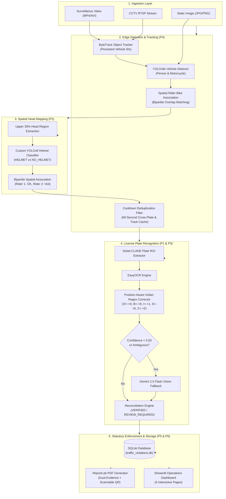

# TwoWheelerViolationAI — Architecture & Technical Design Specification

## 1. Executive Summary

**TwoWheelerViolationAI** is an edge-ready computer vision and automated enforcement platform designed for intelligent traffic surveillance. The platform detects, classifies, associates, tracks, and issues statutory demonstration reports for two-wheeler traffic violations in real time:

- **Riding without protective headgear (helmet)**: Individual rider classification (Section 129 read with Section 194D of the Motor Vehicles Act).
- **More than one pillion rider (triple riding)**: Rider-motorcycle spatial grouping (Section 128 read with Section 194C of the Motor Vehicles Act).
- **Dangerous overloading**: Excess passenger carriage (Section 194A of the Motor Vehicles Act).
- **Automated license plate recognition**: Position-aware Indian vehicle syntax validation and character-level heuristic correction.
- **Multimodal decision reconciliation**: Cloud vision fallback via Google Gemini 2.5 Flash for uncertain or unreadable plates.
- **Continuous video surveillance**: ByteTrack multi-object tracking with 60-second event-deduplication cooldown.
- **Statutory report generation**: Cryptographically hashed, non-payable demonstration PDF e-Challan generation with embedded QR codes.
- **Centralized operations dashboard**: Multi-page Streamlit web application backed by SQLite.

---

## 2. High-Level Architecture



---

## 3. Pipeline Stages & Detailed Subsystems

### P1: License Plate ROI Extraction & Position-Aware Indian Plate Regex
- **Module**: `plate_roi.py` & `plate_ocr.py`
- **Region of Interest Extraction**:
  - Focuses search on the bottom 45% and central 70% of the motorcycle bounding box.
  - Applies bilateral filtering (smoothing without edge blur), horizontal Sobel gradient (`dx=1, dy=0`), morphological closing (`17x3` kernel), and Otsu binarization.
  - Filters rectangular contours with aspect ratio $\in [1.5, 5.0]$ and area $\in [1\%, 45\%]$ of vehicle ROI.
  - Adds 10% safety margin padding around the isolated plate.
- **OpenCV Super-Resolution & Preprocessing**:
  - Bicubic upscaling to normalized width ($320\text{ px}$).
  - Contrast Limited Adaptive Histogram Equalization (CLAHE) on the L-channel in LAB color space.
  - Laplacian kernel sharpening (`[0, -1, 0; -1, 5, -1; 0, -1, 0]`).
- **Position-Aware Character Normalization**:
  - High Security Registration Plates (HSRP) often prepend or append an `IND` stamp, which is systematically stripped.
  - Indian vehicle registration syntax: `^[A-Z]{2}\d{1,2}[A-Z]{1,3}\d{4}$`.
  - State code verification: The first two characters must match one of the 37 authorized Indian State/UT codes (`AP`, `TS`, `DL`, `KA`, `MH`, etc.) or Bharat Series (`BH`).
  - **Syntax-Guided Positional Substitution**:
    - Letters expected (Positions 0-1, and series characters): `0 -> O`, `8 -> B`, `1 -> I`, `5 -> S`, `2 -> Z`.
    - Digits expected (District code & 4-digit serial): `O -> 0`, `B -> 8`, `I -> 1`, `S -> 5`, `Z -> 2`.

---

### P2: Rider-to-Head Spatial Association
- **Module**: `head_association.py` & `helmet_detection.py`
- **Head Zone Extraction**:
  - For each rider bounding box $[x_1, y_1, x_2, y_2]$, the anatomical head region is mathematically modeled as the top 30%:
    $$\text{Head Box} = [x_1 + 0.05 \cdot w, y_1, x_2 - 0.05 \cdot w, y_1 + 0.30 \cdot h]$$
- **Greedy Bipartite Overlap Matching**:
  - Computes intersection over head area between each detected helmet bounding box and rider head region.
  - Matches candidate with maximum overlap; suppresses duplicate assignments.
- **Three-State Compliance Model**:
  - 🟢 `HELMET`: Confirmed protective headgear detected within the head zone.
  - 🔴 `NO_HELMET`: Unhelmeted head detected within the head zone (violation).
  - 🟡 `UNKNOWN`: Neither class detected with high confidence (avoids false-positive violations caused by occlusion or camera angles).

---

### P3: Gemini Multimodal Vision Fallback
- **Module**: `multimodal_verifier.py`
- **Trigger Conditions**:
  - EasyOCR confidence score $< 0.50$.
  - Plate detection returns `PLATE_NOT_DETECTED`.
  - EasyOCR string fails standard Indian syntax regex.
- **API Architecture**:
  - Official Google GenAI SDK (`google-genai`).
  - Uses `gemini-2.5-flash` with automatic fallback to `gemini-1.5-flash`.
  - Strict JSON schema response parsing: `detected_number`, `confidence`, `is_readable`, `explanation`.
  - 12-second timeout with exponential backoff retry.
- **Conservative Decision Reconciliation**:
  - If EasyOCR and Gemini agree: Mark as `VERIFIED`.
  - If they disagree: Mark as `REVIEW_REQUIRED` (requires human officer review).
  - If Gemini is unavailable or offline: Gracefully returns `GEMINI_UNAVAILABLE` without breaking the local OCR result.

---

### P4: Video Processing & ByteTrack Multi-Object Tracking
- **Module**: `video_processor.py`
- **Tracking Algorithm**:
  - Integrates Ultralytics YOLOv8 with ByteTrack (`bytetrack.yaml`).
  - Persistently tracks motorcycles and riders across frames.
- **60-Second Cooldown Deduplication**:
  - Prevents issuing duplicate fines for the same vehicle across frames.
  - Evaluates both vehicle `track_id` and detected license plate string.
  - Cross-plate registry links different track IDs if the same license plate is re-observed within the cooldown window.
- **Evidence Frame Capture**:
  - Automatically snapshots high-resolution violation frames to `evidence/`.
- **Stream Generator**:
  - Provides `process_stream_generator()` yielding `(frame_idx, frame_rgb, active_tracks, new_violations)` for interactive real-time Streamlit video playback.

---

### P5: Interactive Streamlit Web Dashboard & SQLite Database
- **Modules**: `app.py`, `database.py`, `dashboard_pages/`, `ui_styles.py`
- **SQLite Database (`traffic_violations.db`)**:
  - Indexed tables: `challan_records` (indexed on `vehicle_plate`, `date_time`, and `challan_id`).
  - Historical receipt synchronization: Automatically reads legacy `.txt` files from `challans/` into SQLite.
- **5 Dashboard Pages**:
  1. **Dashboard Overview**: Key performance indicators (Total vehicles, violations, helmet offenses, triple riding, verified plates, total penalty sum), pipeline health telemetry, and recent violations feed.
  2. **Image Detection**: Upload custom image or select benchmark presets, run full AI pipeline, inspect side-by-side detections, view license plate crop, and issue e-Challan.
  3. **Video Detection**: Upload MP4/AVI or stream RTSP camera feed with live start/stop controls, real-time ByteTrack boxes, live HUD telemetry, and captured evidence snapshot gallery.
  4. **Challan Management**: Searchable and filterable registry (by plate, violation category, date, and verification status), CSV export, photographic evidence viewer, and ReportLab PDF download.
  5. **Analytics & Reports**: Offense category distributions, repeat offender rankings, source breakdown (Image vs. Video vs. Historical), and audit quality metrics.

---

### P6: Advanced PDF Challan Generator
- **Module**: `pdf_challan_generator.py` & `fine_generator.py`
- **Legal Compliance & Statutory Grounding**:
  - Citations verified against the official Gazette of India for the Motor Vehicles (Amendment) Act, 2019:
    - **Section 129 / 194D**: Helmet violation (₹1,000 per unhelmeted rider).
    - **Section 128 / 194C**: Triple riding (₹1,000 compound fine).
    - **Section 194A**: Dangerous overloading (₹2,000 compound fine).
    - **Section 136A**: Electronic monitoring and electronic violation notices.
- **Non-Payable Demonstration QR Code**:
  - Dynamically generated using `qrcode` and PIL.
  - Encodes simulated verification URL with cryptographic SHA-256 audit token.
  - Explicitly non-payable and marked `DEMO ONLY • NON-PAYABLE`.
- **Fault-Tolerant Placeholder Generator**:
  - Dynamically creates PIL placeholder graphics when images are missing or unreadable, preventing document compilation failures.
- **Organized Storage**:
  - Automatically archives reports to `challans/pdf_reports/`.

---

## 4. Module Dependency Map

```text
[app.py] (Streamlit UI Entry Point)
   ├── [ui_styles.py] (CSS & Visual Components)
   ├── [database.py] (SQLite Storage & Analytics)
   ├── [pdf_challan_generator.py] (ReportLab & QR Generator)
   └── [dashboard_pages]
         ├── [overview.py]
         ├── [image_detection.py]
         │     ├── [head_association.py]
         │     ├── [plate_roi.py]
         │     ├── [plate_ocr.py]
         │     └── [multimodal_verifier.py]
         ├── [video_detection.py]
         │     └── [video_processor.py]
         │           ├── [head_association.py]
         │           ├── [plate_ocr.py]
         │           └── [fine_generator.py]
         ├── [challan_management.py]
         └── [analytics.py]
```

---

## 5. Security, Ethics & Academic Disclaimer

1. **Non-Enforceability**: This software is strictly for academic research and algorithm benchmarking. It is **not** connected to government enforcement databases (e.g., Parivahan, NIC) and carries no statutory authority.
2. **No Real Monetary Transactions**: All QR codes and payment references are simulated demonstration records.
3. **Privacy**: Personal identifying information in local databases is kept local within `traffic_violations.db`.
